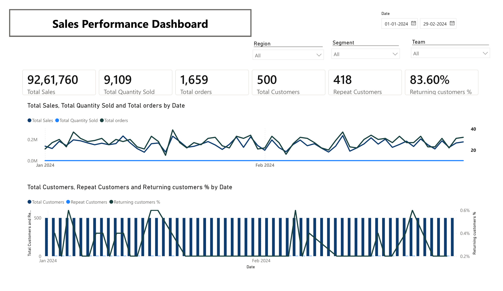

# Sales Performance Dashboard | Power BI

An interactive Power BI report for reviewing sales, order volume, quantity, and customer activity across January–February 2024.

## Dashboard Preview

[View the dashboard PDF](Sales%20Performance%20Dashboard.pdf) · [Open the Power BI report](Sales%20Performance%20Dashboard.pbix)

## Business Questions
- How do sales, order volume, and quantity change over time?
- What proportion of customers are returning customers?
- How do results compare across Region, Segment, and Team filters?

## Key Metrics
For **1 January–29 February 2024**, with all Region, Segment, and Team filters applied:
- **Total sales:** 9,261,760
- **Quantity sold:** 9,109
- **Orders:** 1,659
- **Customers:** 500
- **Repeat customers:** 418
- **Returning-customer metric:** 83.60%

## Business Insights
- The dashboard shows 418 repeat customers among 500 customers in the selected view.
- Sales and order counts vary over the displayed dates; date-level visuals can help identify peaks and dips for further investigation.
- Region, Segment, and Team slicers support comparisons across business groups.

> These are descriptive dashboard readings, not causal or profitability conclusions. The PDF includes another date view with different totals; the metrics above refer specifically to the Jan–Feb 2024 view.

## Tools
**Power BI · Excel**

## Dataset
Sales dataset containing approximately 10K records.

## How to Explore
1. View the PDF for a static overview.
2. Open the PBIX file in Power BI Desktop to interact with visuals and filters.

---
Created by **Jithesh D** · [GitHub](https://github.com/jithesh127)